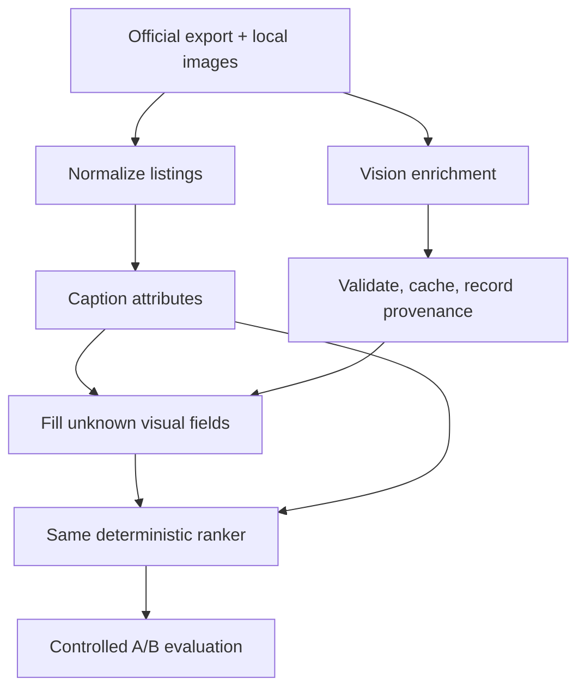

# Occasion retrieval from fragmented social-commerce inventory

A privacy-conscious retrieval experiment for recommending rental dresses from
semi-structured Instagram inventory. The project asks a narrow technical
question: **can image-derived garment attributes improve an explainable,
deterministic ranker when listing captions omit most visual details?**

The current system includes a caption-only baseline, live Anthropic vision
enrichment behind a provider-neutral contract, provenance-aware merging, and a
controlled evaluation harness. It has **296 passing tests**.

## What the system does

The pipeline converts noisy rental listings into event-specific ranked results:

1. Parse the user's official Instagram export locally.
2. Normalize rental listings without inventing missing facts.
3. Apply hard constraints such as size, price, and availability.
4. Score the survivors on interpretable fit, event, style, seasonality, price,
   and availability components.
5. Optionally use a vision model to fill visual attributes that captions left
   unknown, then rerun the **same** ranker with the **same** settings.

The vision model does not rank dresses. It produces structured observations;
the deterministic ranker remains the decision layer.

## Why image enrichment was added

The caption baseline established a useful floor: it could enforce constraints
and explain its scores, but captions described transactional facts far better
than visual style. Neckline, silhouette, colour, sleeve, fabric, and
embellishment were often unknown, so different event queries could collapse
toward similar results.

Image enrichment was therefore introduced as a controlled observability
experiment. Arm A uses caption attributes. Arm B starts with those same
attributes and lets vision fill only unknown visual fields above a confidence
threshold. Filters, weights, thresholds, sorting, and explanation logic remain
fixed between arms.

## First live experiment

The first live Anthropic run successfully enriched **7 of 7 reachable anchor
images**, with **91.4% mean attribute coverage**.

| Result | Observation |
|---|---:|
| Full-catalog top-10 nDCG | Flat between caption and enriched arms |
| Catalog coverage | 7 of 157 candidates enriched (4.5%) |
| Comparable anchors | 6 |
| Anchor rank movement | 5 improved; 1 moved down by one place |
| Mean anchor rank improvement | +20.5 places |
| Mean anchor score delta | +0.0301 |

This is **directional item-level evidence**, not proof that vision improved
top-10 retrieval. The aggregate metric remained flat because enrichment reached
only 4.5% of the candidate pool, which was too sparse to test a catalog-level
ranking change fairly. The result supports scaling the same controlled
experiment; it does not justify changing the ranker or claiming a system-wide
quality gain.

See [the experiment report](docs/VLM_EXPERIMENT_RESULTS.md) for the full
interpretation and next-step design.

## Architecture at a glance



The main boundaries are deliberate:

- **Caption authority:** size, price, availability, and stated dates are never
  overridden by vision.
- **Fill-only policy:** known caption values stay; disagreements are recorded as
  conflicts rather than silently replaced.
- **Provider neutrality:** provider-specific responses are normalized before
  they reach ranking.
- **Reproducibility:** model version and prompt/contract fingerprint are part of
  extraction provenance and cache identity.
- **Evaluation isolation:** only the attribute source changes between arms.

Read [the architecture guide](docs/ARCHITECTURE.md) for component and trust
boundaries.

## Privacy and provenance

No private export, downloaded image, real caption, permalink, username,
relevance label, API credential, or row-level live result is committed.
Sensitive artifacts remain under gitignored `data/local/` paths.

Each accepted visual observation retains its source, confidence, evidence,
provider, model version, and contract fingerprint. This makes it possible to
audit which facts came from caption text, which came from vision, and how a
conflict was resolved without publishing the underlying private content.

See [DATA_HANDLING.md](docs/DATA_HANDLING.md).

## Evaluation philosophy

Every sophistication layer must earn its place against a simpler baseline. A
negative or flat result is preserved when it identifies the next useful
experiment. Here, flat top-10 nDCG and positive anchor movement tell different,
compatible stories: the provider produced useful attributes for the items it
saw, while the treatment was too sparse to establish full-catalog lift.

The next experiment is to enrich the full reachable inventory—or a predeclared,
coverage-balanced sample—then repeat the same A/B with unchanged ranking
settings. Primary outcome: nDCG@10. Secondary diagnostics: anchor movement,
attribute coverage, top-k overlap, hard-filter survivors, conflicts, and cutoff
ties.

## Repository guide

| Document | Purpose |
|---|---|
| [Architecture](docs/ARCHITECTURE.md) | Current components, data flow, and trust boundaries |
| [First live results](docs/VLM_EXPERIMENT_RESULTS.md) | Results, limitations, and next experiment |
| [Evaluation plan](docs/VLM_EVALUATION_PLAN.md) | Controlled experiment and metric definitions |
| [ADRs](docs/adr/) | Decisions, alternatives, and consequences |
| [Decision register](docs/DECISIONS.md) | Locked, reversible, and pending choices |
| [Data handling](docs/DATA_HANDLING.md) | Public/private boundary |
| [Repository structure](docs/REPO_STRUCTURE.md) | Code and artifact locations |

## Local setup

```bash
uv sync
uv run pytest
```

Tests and synthetic examples run without private data or live model calls. Live
vision enrichment is opt-in and requires local credentials; credentials and
outputs remain outside Git.

Requires Python 3.12+.
