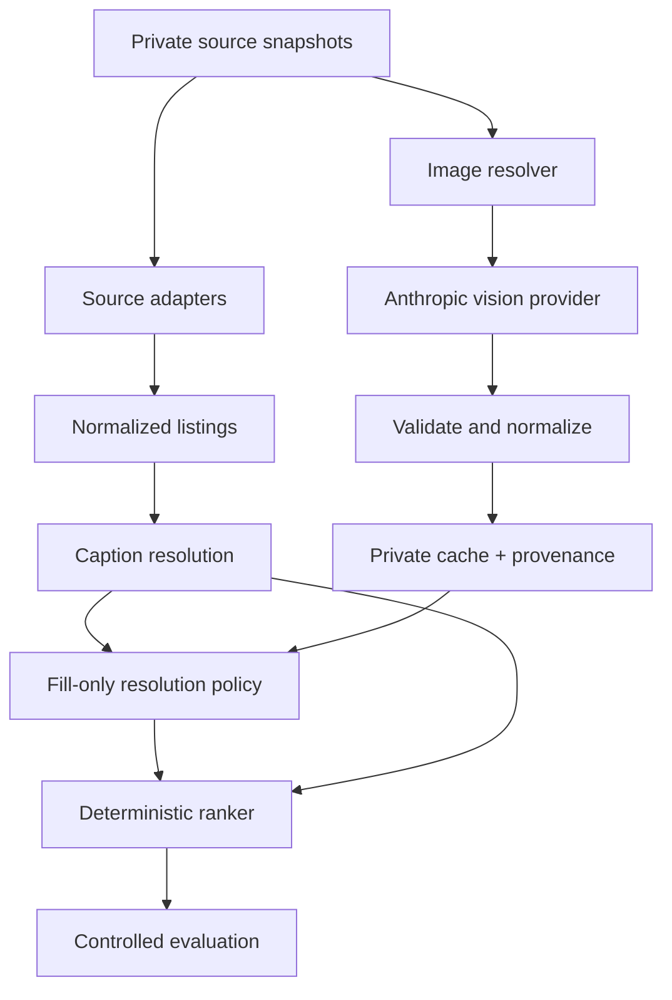

# Current architecture

This document describes the system that exists now. Longer-term embedding,
vector-search, and personalization ideas remain separate roadmap decisions.

## Design question

The architecture is organized around one experiment:

> Can structured visual observations make an interpretable ranking system more
> useful without allowing a model to replace hard constraints or the ranker?

That question requires a stable baseline, a narrow enrichment boundary, and an
evaluation in which the attribute source is the only intended difference.

## End-to-end flow

## 1. Deterministic caption baseline

The baseline extracts only what listing text supports, preserves unknowns, and
then applies:

1. hard filters for explicit incompatibility;
2. interpretable fit, style, event, seasonality, price, and availability scores;
3. coverage-aware score combination;
4. deterministic sorting and explanations derived from score components.

This baseline matters because a visual system needs something stable to beat.
It also exposes the motivating failure: captions often contain price and size
but omit visible garment construction.

## 2. Vision enrichment boundary

The live provider receives an image reference and returns a structured visual
record. Provider-specific response details stop at the enrichment package.
Normalization converts them to controlled vocabularies and treats malformed,
partial, or unsupported values as unknown rather than guessing.

The cache identity incorporates the image and extraction contract, including
provider/model and prompt/schema fingerprint. Changing the extraction contract
therefore cannot silently reuse an incompatible result.

## 3. Resolution policy

The provider does not receive authority over ranking facts. The merge policy is
intentionally conservative:

| Situation | Resolution |
|---|---|
| Caption visual value is unknown; confident vision value exists | Fill the unknown |
| Caption and vision agree | Preserve the value and both observations |
| Caption and vision disagree | Keep caption; record a conflict |
| Vision confidence is below the floor | Do not fill |
| Image is unusable | Return the caption resolution unchanged |
| Field is transactional | Vision cannot write it |

Size, rental price, availability, and stated dates remain outside vision's
authority. Seven visual keys currently project into the ranker: length, colour
family, sleeve, neckline, silhouette, sparkle, and fabric. Richer attributes
remain available for later experiments but do not silently change current
scoring.

## 4. One ranker, two experiment arms

The controlled evaluation uses one settings object and the same inventory,
profile, event, weights, quality threshold, retained depth, filters, scoring,
sort order, and explanation code.

- **Arm A:** deterministic caption resolution.
- **Arm B:** the same caption resolution plus fill-only visual observations.

Because the ranker is shared, a measured difference can be attributed to
changed attribute observability rather than a second ranking algorithm.

## 5. Provenance and auditability

Each observation can retain:

- source (`caption` or `vision`);
- normalized value;
- confidence;
- short evidence;
- provider and model version;
- prompt/schema contract fingerprint.

Conflicts are surfaced on the ranked result. Explanations continue to come from
the same components that produced the score; model prose is not used as a
ranking explanation.

## 6. Privacy boundary

The public repository contains schemas, logic, synthetic fixtures, tests, and
aggregate experiment results. The following remain under gitignored
`data/local/` paths:

- official exports and normalized private inventory;
- downloaded images and resolved image references;
- model-response caches;
- real captions, usernames, shortcodes, and permalinks;
- relevance labels and row-level evaluation outputs;
- credentials.

Live provider calls are opt-in. Public tests use deterministic doubles or
synthetic data and do not require private content or network access.

## 7. Failure containment

An individual unavailable image, malformed model response, low-confidence
field, or unusable photograph should degrade to missing enrichment for that
listing. It must not convert an unknown into a negative fact or prevent the
caption-only path from running.

## What is deliberately not claimed

- Vision does not replace the ranker.
- The first seven-image run does not establish full-catalog retrieval lift.
- Attributes not consumed by current scoring cannot improve ranking yet.
- Planned embeddings, vector retrieval, or reranking are not presented as
  completed components.

See [VLM_EXPERIMENT_RESULTS.md](VLM_EXPERIMENT_RESULTS.md) for the first live
result and [ADR 006](adr/0006-provider-neutral-visual-enrichment.md) for the
provider-neutral boundary decision.
